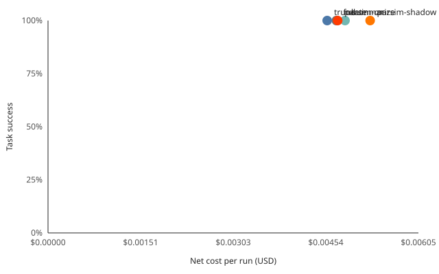

# Benchmark: support agent, groq openai/gpt-oss-120b

> **Development run, not for publishing.** It used a free-tier model; costs are at the model's list price.

**Parsim on: 0.5% higher net cost, success 100.0% vs 100.0% for full context. Truncation: 3.2% lower net cost, success 100.0%.**

- Command: `npm run bench -- --agent support --runs 1 --provider groq --tasks 4 --yes`
- Model: groq `openai/gpt-oss-120b`; internal model (summaries): `openai/gpt-oss-120b`
- Parsim: backend 1.2.0, commit `db86391`
- Run date: 2026-10-17T18:42:30.025Z to 2026-10-17T18:53:52.209Z
- Runs: 1; tasks: the first 4 of the support agent; tools replay recordings; temperature 0
- Baselines: last N = 6 turns kept; summary refreshed every M = 6 turns
- Prices (USD per 1M tokens): model input 0.15, cached input 0.075, output 0.6. Free tier: the run cost nothing; costs are at the list price, so arms can be compared.

## Results by arm

| Arm | Success | vs full | Input tokens | Output tokens | Cached | Raw cost | Net cost | Cache-adjusted | Net vs full | Recalls | Wall time |
| --- | --- | --- | --- | --- | --- | --- | --- | --- | --- | --- | --- |
| full | 100.0% ± 0.0% | - | 25,696 | 1,430 | 4,864 | $0.00471 | $0.00471 | $0.00435 | - | 0.0 | 122.6s |
| truncate | 100.0% ± 0.0% | single run | 20,419 | 2,499 | 3,584 | $0.00456 | $0.00456 | $0.00429 | 3.2% lower | 0.0 | 77.5s |
| summarize | 100.0% ± 0.0% | single run | 21,319 | 1,720 | 6,400 | $0.00423 | $0.00485 | $0.00375 | 3.0% higher | 0.0 | 139.1s |
| parsim-shadow | 100.0% ± 0.0% | single run | 25,962 | 2,282 | 11,264 | $0.00526 | $0.00526 | $0.00442 | 11.7% higher | 0.0 | 130.4s |
| parsim-on | 100.0% ± 0.0% | single run | 25,074 | 1,621 | 13,056 | $0.00473 | $0.00473 | $0.00375 | 0.5% higher | 0.0 | 114.0s |

## Success by task type

| Arm | normal |
| --- | --- |
| full | 100.0% (4 tasks) |
| truncate | 100.0% (4 tasks) |
| summarize | 100.0% (4 tasks) |
| parsim-shadow | 100.0% (4 tasks) |
| parsim-on | 100.0% (4 tasks) |

## Latency

| Arm | p50 per step | p95 per step | Overhead vs full (p50 / p95) | Rate-limit waits |
| --- | --- | --- | --- | --- |
| full | 847 ms | 20,456 ms | - | included above |
| truncate | 1,184 ms | 14,836 ms | - | included above |
| summarize | 8,837 ms | 21,321 ms | - | included above |
| parsim-shadow | 7,849 ms | 16,128 ms | 7,002 ms / -4,328 ms | included above |
| parsim-on | 6,911 ms | 19,981 ms | 6,064 ms / -475 ms | included above |

> In this run the time per step includes the waits for the provider's rate limits (they were not recorded apart), so the latency and overhead above mostly measure those waits, not Parsim.

## Recalls

- parsim-shadow: 0.0 recalls per run; 0.0 brought back a fact the task needed
- parsim-on: 0.0 recalls per run; 0.0 brought back a fact the task needed

## Side-effect safety

Every arm's side-effect calls against the full arm in the same run: a call missing, made twice, made with a different value (status or answer), or extra.

| Arm | Missing | Duplicated | Changed | Extra |
| --- | --- | --- | --- | --- |
| truncate | 0 | 0 | 0 | 0 |
| summarize | 0 | 0 | 0 | 1 |
| parsim-shadow | 0 | 0 | 0 | 0 |
| parsim-on | 0 | 0 | 0 | 0 |

summarize:
- run 1: extra send_reply for t ...

## Method

- **Arms:** full context without Parsim; naive truncation (system prompt, first user goal and the last N turns); naive summarization (one internal-model summary of everything older than N turns, refreshed every M turns); Parsim in shadow mode; Parsim on. All arms run the same tasks with the same model, temperature 0 and the same tool recordings.
- **Success:** exact checks of each task's expected answer against the side-effect log (`save_report`, `update_ticket` and `send_reply`). With `--judge`, the internal model also grades each task against its checklist.
- **Significance:** One run: there is no run-to-run spread, so no difference can be called significant.
- **Cost:** raw prices every input token at the input price; net adds what Parsim sent upstream for recalls, Parsim's compression summaries and the summarize baseline's summaries; cache-adjusted prices cached input tokens at the cached input price.
- **Latency:** time per model call, as the agent saw it. Overhead is the Parsim arm's p50 and p95 minus the full arm's.

Raw numbers: [2026-10-17-support-groq-openai-gpt-oss-120b.json](2026-10-17-support-groq-openai-gpt-oss-120b.json)
